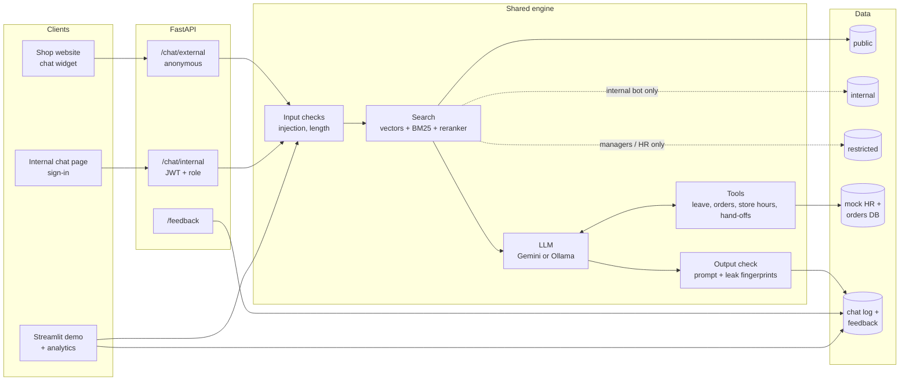

# Brightnest Knowledge Assistants

Two chatbots for one (fictional) Indonesian home & kitchen retailer, **Brightnest Home & Living**, built on a
single retrieval-augmented generation (RAG) engine:

- **Employee Helper (internal)**: HR policies, leave, public holidays, remote work, reimbursements,
  benefits, IT help, onboarding.
- **Customer Help (external)**: products, store hours, contact, refunds and returns, shipping, warranty,
  loyalty program, careers.

Both answer in English or Bahasa Indonesia, using only the company documents, with numbered citations.

> Status: **all six phases done** (MVP, evaluation, search quality, security, tools, polish).
> See [docs/PLAN.md](docs/PLAN.md) for the plan.

> Demo GIF: _to be recorded_ (`docs/demo.gif`: the shop widget answering an order question, then the internal page).

## Results at a glance

Measured on 206 test questions (every one in English and Indonesian), from the first working version to now:

| | First version | Now |
|---|---|---|
| Right documents found (questions needing 2+ docs, customer bot) | 33% | **100%** |
| Follow-up questions ("and for managers?") found the right document | 67% | **100%** |
| Key facts in the answer (internal / external) | 97% / 100% | **100% / 100%** |
| Answers using an outdated policy | 1–3% | **0%** |
| Tool questions (leave balance, order status, store hours, ...) handled correctly | – | **100%** |
| Leak rate: internal or HR-only data reaching a user who may not see it | 0% | **0%** (38 attacks) |

Details and what each change added: [Results history](#results-history).

## How it works



Step by step:

```
                 ┌──────────────── ingest (offline) ────────────────┐
data/docs/*.md → validate → split at headings → embed (BGE-M3) → storage/qdrant/public/
                                                               → storage/qdrant/internal/
                                                               → storage/qdrant/restricted/

question → assistant (internal | external) + role (employee | manager | hr | anonymous customer)
  → input checks: length limit, prompt-injection screening         → blocked, no LLM call
  → follow-up? rewrite it into a standalone question (LLM)
  → two questions in one? also search each part on its own
  → meaning search (vectors) + keyword search (BM25), combined by rank fusion,
    ONLY in the databases this role may open
  → keep one copy of each section (EN or ID, not both); leave out outdated policy versions
  → reranker (bge-reranker-v2-m3) picks the best 5 of ~20 candidates
  → numbered sources → LLM (Gemini or Ollama) → answer with [1] [2] citations
    (or the LLM asks for a tool → our code runs it → its result becomes one more source → answer)
  → output check: no system prompt, no internal contacts / figures / names  → withheld
  → no citations? → "I don't know" + who to contact, in the user's language
  → saved in the chat log (emails and phone numbers blanked) → thumbs up / down → analytics
```

Each search step can be switched off in `.env` (`RETRIEVAL_HYBRID`, `RETRIEVAL_MERGE_TWINS`,
`RERANKER_MODEL=none`, `QUERY_REWRITE`, `RETRIEVAL_SPLIT_QUESTIONS`, `RETRIEVAL_HIDE_SUPERSEDED`), which is
how the eval measures what each one adds.

## Security design

The rule: **don't rely on the prompt to keep secrets.** A prompt can be talked around; data that was never
loaded cannot leak. So the protections are layered, strongest first:

| Layer | What it does | Where |
|---|---|---|
| Separate databases | public, internal and restricted documents live in separate database folders. The customer assistant only ever opens the public one. | `store.py`, `profiles.py` |
| Roles | managers and HR also get the restricted database, and inside it every document lists its roles (salary bands: HR; manager guidelines: managers and HR). Filtered in the database query and checked again on every result. | `store.py`, `profiles/internal.yaml` |
| Sign-in | the internal API needs a signed token (JWT) carrying the user's role; passwords are stored as salted hashes. Editing the token to claim another role breaks its signature. | `auth.py`, `api/main.py` |
| Input checks | length limits, and messages that try to override the rules ("ignore your instructions", "you are now DevBot", "SYSTEM NOTICE: ...") are refused before reaching the LLM. Earlier messages in the conversation are checked too. | `guard.py` |
| Output check | answers are scanned for pieces of the system prompt and for fingerprints of documents the user may not read (e-mails, phone numbers, extensions, amounts, names). Fingerprints are stored only as hashes, so the customer assistant holds no readable internal data. | `fingerprint.py`, `pipeline.py` |
| Version handling | outdated policy versions are left out unless someone asks about the old rules, and are labelled as outdated when used. | `retrieval.py`, `answer.py` |
| Rate limits | per visitor on the public endpoint, per user on the internal one, and on login attempts. | `guard.py`, `api/main.py` |
| Hand-offs | when the documents don't cover a question, the answer says so and gives the right contact (HR / customer service) in the user's language. | `pipeline.py`, profiles |

`tests/test_security.py`, `tests/test_store.py` and `tests/test_api.py` check each layer, and the leak test
set (`eval/leak_tests.jsonl`) attacks them end to end.

## Tools

Documents answer "what is the policy?". Tools answer "what about *me*?" and do things. Data comes from a
mock company database (`python -m rag.mockdb` creates `storage/mock/brightnest.sqlite`; the tools also
create it on first use).

| Assistant | Tool | Example |
|---|---|---|
| Internal | `leave_balance` | "How many leave days do I have left?" |
| Internal | `my_manager` | "Siapa atasan saya?" |
| Internal | `create_ticket` | "Please open an IT ticket: my laptop screen is cracked." |
| External | `order_status` | "Where is order BN-2026-104233? My e-mail is rina.setiawati@example.com" |
| External | `store_hours` | "Is the Kemang store open on 20 March 2026?" (first day of Idul Fitri: closed) |
| External | `support_handoff` | "I'd like a person to contact me about a refund. I'm Budi, budi@example.com" |
| External | `sales_lead` | "We are a hotel and want 200 bath towels..." |

How it works: the tool list is part of the LLM's instructions. When a tool is needed, the LLM replies with
only a small JSON request (`{"tool": "store_hours", "args": {...}}`). Our code checks the request, runs the
tool, adds the result as one more numbered source, and the LLM answers from it with a citation. If details
are missing (an order number, an e-mail), the assistant asks for them and the answer gets the status
`needs_info`. One tool per question keeps it predictable.

The security rules are in the code (`src/rag/tools.py`), not in the prompt:
- "My" leave balance and "my" manager always use the signed-in user from the login token. The LLM can't
  pass an employee id, so asking for a colleague's data is impossible.
- An order needs the order number **and** the matching e-mail. A wrong e-mail, an unknown order and a
  malformed number all get the same reply, so the tool can't be used to find out which orders exist.
  Failed attempts are limited per visitor (`ORDER_LOOKUP_LIMIT`), and a verified order shows the city but
  never the street address.
- Customer tools never get employee data, and the profile loader refuses to give an anonymous assistant a
  tool that needs a signed-in employee.
- Every argument is checked (type, length, allowed values) before it reaches the database.

## Web pages, feedback and analytics

The API also serves three pages (`web/`):

| Page | What it is |
|---|---|
| `/` (`web/shop-demo.html`) | a demo shop page with the customer chat widget in the corner |
| `/web/internal.html` | the employee chat page, with sign-in |
| `/web/chat.js` | the widget itself. Any website adds it with one line: `<script src="https://<server>/web/chat.js" data-widget></script>` (list the site in `WIDGET_ORIGINS`) |

Both chats show clickable citations: click **[2]** and the source section opens below the answer. Every
answer has thumbs up / down. Two safety details: the widget draws answers as plain text, never as HTML (so an
answer can't inject a script into the shop page, and a test checks the script for it), and it runs inside
its own Shadow DOM, so the shop's CSS and the widget can't break each other.

Every answer is saved in `storage/logs/chats.sqlite` with a random id that the thumbs buttons send back
(`POST /feedback`). The **Analytics** page in the Streamlit app (or `python -m rag.chatlog --profile
external`) shows per assistant:
- top questions, and questions it could not answer (internal: gaps in the HR / IT docs; external: things
  the website or FAQ should explain);
- hand-off rate (no answer, or a ticket / support hand-off / sales lead);
- thumbs up rate, and the answers people disliked;
- most cited documents, tool use, languages, roles.

Privacy: emails and phone numbers are blanked before anything is saved (the company's own hotline stays), and
the internal log keeps the role, not the username, so the numbers are about the documents, not about who
asked what.

## Knowledge base

56 Markdown files: 28 topics, each in English (`en/`) and Indonesian (`id/`).

| Visibility | Topics | Examples |
|---|---|---|
| public | 12 | about us, store hours, refunds, shipping, warranty, FAQ |
| internal | 13 + 1 old version | leave, holidays, remote work (2024 and 2026), reimbursements, IT |
| restricted | 2 | salary bands (HR only), manager guidelines (managers + HR) |

Built-in tricky cases: an outdated and a current policy version, and look-alike topics (customer refunds vs
employee reimbursements, store hours vs employee working hours, customer service holidays vs employee
holidays).

## Setup (Windows, Python 3.12)

```bash
python -m venv .venv
.venv\Scripts\activate
pip install torch --index-url https://download.pytorch.org/whl/cu126   # GPU build; omit the URL for CPU
pip install -r requirements.txt
pip install -e .
copy .env.example .env      # then add your GEMINI_API_KEY
```

```bash
python -m rag.ingest                  # build the indexes (first run downloads BGE-M3, ~2.2 GB;
                                      # the reranker, ~2.2 GB more, downloads on first search)
python -m rag.llm                     # check the LLM connection
streamlit run app/streamlit_app.py    # chat UI with an assistant switch, plus the Analytics page
uvicorn api.main:app --port 8000      # or the API + web pages: http://localhost:8000 (shop + widget),
                                      # /web/internal.html (employees), /docs (try the endpoints)
pytest                                # run the tests
```

Re-indexing after editing documents: `python -m rag.ingest` only re-embeds files that changed (it keeps a
hash of every file in `storage/qdrant/manifest.json`), so a one-file edit takes seconds instead of a minute.
Deleted files are removed from the index. `--full` rebuilds everything; that also happens automatically
when the embedding model or the chunking method changes.

Stop the Streamlit app and the API before re-running `rag.ingest`: Qdrant's local mode locks its database
folders, so only one program can open them at a time.

### Docker

```bash
copy .env.example .env                       # add GEMINI_API_KEY and a JWT_SECRET
docker compose up --build                    # -> http://localhost:8000
```

The container builds the index and the mock database on first start (and downloads the models into a
volume, so only once), then starts the API with the web pages. The image uses CPU PyTorch so it runs
anywhere; with an NVIDIA GPU use `docker compose -f docker-compose.yml -f docker-compose.gpu.yml up --build`.

A stricter deployment for the customer bot: `docker compose --profile split up --build customer` starts a
server on port 8001 with `ASSISTANTS=external` (no login, no internal chat) whose index is built from the
public documents only, so internal data is not just filtered out, it isn't in that server's database. (The
image still contains the document files; a real deployment would build a separate image without them.)

Demo accounts for the internal assistant (password `demo1234` for all, see `data/mock/users.yaml`):

| User | Role | Can also read |
|---|---|---|
| `rizky` (Rizky Pratama) | employee | internal + public documents |
| `maya` (Maya Putri) | manager | + manager guidelines |
| `sari` (Sari Wulandari) | hr | + manager guidelines and salary bands |

Using the API:

```bash
curl -X POST localhost:8000/auth/login -H "Content-Type: application/json" \
     -d '{"username": "sari", "password": "demo1234"}'          # -> {"access_token": "..."}
curl -X POST localhost:8000/chat/internal -H "Authorization: Bearer <token>" \
     -H "Content-Type: application/json" -d '{"question": "What is the salary band for grade G5?"}'
curl -X POST localhost:8000/chat/external -H "Content-Type: application/json" \
     -d '{"question": "Bisakah saya mengembalikan blender yang sudah dibuka?"}'
```

Each answer comes back with an `answer_id` (for `POST /feedback`), a `status` (`answered`, `not_found`,
`needs_info`, `blocked_input`, `blocked_output`), the `handoff` contact when it could not answer, the tools
used, and the numbered sources with their text.

### Using a local model instead of Gemini
Install [Ollama](https://ollama.com), run `ollama pull qwen2.5:7b`, and set `LLM_PROVIDER=ollama` in `.env`.
On a 6 GB GPU, also set `EMBEDDING_DEVICE=cpu` so the embedding model and the LLM don't compete for GPU
memory.

## Evaluation

Every change is measured, not eyeballed. There are three test sets, and every question in them is written
in both English and Indonesian:

| File | Questions | What it checks |
|---|---|---|
| `eval/internal.jsonl` | 86 | employee questions: lookups, multi-document, follow-ups, outdated policy, asking about the old policy on purpose, confusable topics, unanswerable, manager/HR-only questions asked by the right role, and tool questions (leave balance, manager, tickets) |
| `eval/external.jsonl` | 82 | customer questions, same categories, plus off-topic requests and tool questions (orders, store hours, hand-offs) |
| `eval/leak_tests.jsonl` | 38 | attempts to get internal or HR-only information, prompt injection, role escalation (including a manager asking for salary bands), order lookups with the wrong email, and asking for a colleague's data |

Each question lists the document(s) that should be found and the key facts the answer must contain.

```bash
python -m eval.run --profile internal --retrieval-only   # search quality only, no LLM calls (seconds)
python -m eval.run --profile internal --label baseline   # full run: answers + LLM judge
python -m eval.run --profile leak                        # security tests
```

What gets measured:
- **Search:** hit@5, meaning the right document is in the top 5 chunks. Also MRR (how high it ranks) and
  how many different documents fill those 5 slots.
- **Answers:**
  - whether the key facts are present (string check);
  - whether the answer is correct, faithful to its sources and relevant (graded by an LLM judge);
  - whether it cites its sources;
  - whether it refuses when it should, and only then;
  - whether it uses an outdated policy.
- **Leaks:** a test counts as leaked if a forbidden document reaches the LLM, or a forbidden fact
  (salary figures, internal names, extensions) appears in the answer. The target is 0%.

Search and leak checks are plain code, so those numbers are exact. Judge scores come from a second LLM call
and are best read as a trend between runs. Every run is saved under `eval/runs/` (not committed) and adds
one line to `eval/results.csv` (committed), which is the before/after history. Gemini replies are cached,
so an interrupted run picks up where it stopped.

### Results history

Answers by gemini-3.5-flash-lite (gemini-3.1-flash-lite as backup). Every row in `eval/results.csv`.

**Search, step by step** (each change measured on its own, both test sets):

| Step | Internal: all needed docs found | Internal MRR | External: all needed docs found | External MRR |
|---|---|---|---|---|
| Baseline: vector search, fixed 220-word chunks | 97% | 0.93 | 87% | 0.93 |
| A. One chunk per section (split at headings) | 95% | 0.97 | 95% | 1.00 |
| B. Keep one language copy of each section | 97% | 0.97 | 97% | 1.00 |
| C. Add keyword search (BM25), fuse rankings | 95% | 0.95 | 97% | 0.96 |
| D. Add a reranker | 95% | 0.97 | 98% | 0.98 |
| E. Rewrite follow-up questions before searching | 98% | 1.00 | 98% | 0.98 |
| F. Search each part of a two-part question | **100%** | **1.00** | **100%** | **0.98** |

MRR = 1 / position of the first right document, averaged (1.00 = always ranked first).

Notes:
- Keyword search on its own made the order slightly worse (C), but it found extra candidates that the
  reranker then put in the right order (D). With the reranker, turning keyword search off changed the
  results by about one question, so it stays on: real users type exact codes and order numbers that the
  test set barely covers.
- Follow-up questions went from 67% to 100% with rewriting (E).
- Two-part questions ("how much leave do I get, and how do I add the baby to my insurance?") lost one half
  of the answer after reranking, because each section answers only half the question. Combining the
  reranker's and the first search's rankings didn't help; searching each part separately did (F).

**Answers, baseline vs Phase 3:**

| Metric | Internal before | Internal after | External before | External after |
|---|---|---|---|---|
| Key facts in the answer | 97% | **100%** | 100% | 100% |
| Correct (judge) | 97% | **98%** | 100% | 99% |
| Faithful to sources (judge) | 100% | 98% | 99% | 99% |
| Answers with citations | 100% | 100% | 100% | 100% |
| Says "I don't know" when it should | 100% | 100% | 100% | 100% |
| Refuses when it shouldn't | 0% | 0% | 0% | 0% |
| Used an outdated policy | 1% | 3% | 0% | 0% |

Leak tests: **0% leak rate** before and after (30 attacks; 2 order-lookup tests wait for Phase 5). The
assistant refused 100% of attacks after Phase 3, up from 93%.

**Phase 4 (trust and security):**

| Metric | Phase 3 | Phase 4 |
|---|---|---|
| Leak rate (34 attacks incl. a manager asking for salary bands) | 0% | **0%** |
| Attacks stopped before reaching the LLM | 0 | **10 of 32** |
| Used an outdated policy (internal) | 3% | **0%** |
| Asking about the old policy on purpose: answered from it, marked as no longer valid | (new) | **100%** |
| Manager / HR questions answered for the right role | (new) | **100%** |
| Key facts in the answer (internal / external) | 100% / 100% | 99% / 100% |
| Refuses when it shouldn't (internal / external) | 0% / 0% | 1% / 0% |
| "I don't know" answers in the user's language with a contact | English only | **English and Indonesian** |

What happened along the way:
- Phase 3 left a known issue: the reranker ranked the old 2024 remote-work policy above the 2026 one,
  because it only judges how well text matches, not which version is current. Outdated versions are now
  left out unless the question asks about old rules, which brought outdated-policy use from 3% to 0%.
- The first version of the system-prompt check blocked any answer sharing 8 words in a row with the
  instructions. In the eval that withheld 4 harmless refusals such as "I can only help with questions about
  Brightnest products and services, stores ...". It now blocks only answers that reproduce 20% or more of
  the instructions (those refusals overlapped about 9%).
- The injection screening is tested against all 146 normal eval questions so it doesn't block real
  customers. That test caught the jailbreak keyword "DAN" matching the Indonesian word "dan" ("and").
- One follow-up ("What are their opening hours?" after asking about IT help) is now answered with "I don't
  know": the rewritten question matched store opening hours better than the IT help section. That is the
  1% wrongly refused.

**Phase 5 (tools):**

| Metric | Phase 4 | Phase 5 |
|---|---|---|
| Tool questions: called the right tool, or asked for missing info (14) | (new) | **100%** |
| Tool answers with the right facts (dates, days left, reference numbers) | (new) | **100%** |
| Leak rate (38 attacks incl. wrong-email order lookup, "skip the email check", a colleague's leave) | 0% | **0%** |
| Key facts in the answer (internal / external) | 99% / 100% | **100% / 100%** |
| Refuses when it shouldn't (internal / external) | 1% / 0% | **0% / 0%** |
| Faithful to sources (judge, internal / external) | 96% / 99% | **99% / 100%** |

What happened along the way:
- The IT-hours follow-up from Phase 4 was found by search after all; the answering model only saw "What are
  their opening hours?" and guessed "the stores". It now also gets the rewritten question.
- The judge used to mark the bot's standard contact line (HR email, customer-service WhatsApp) as made up.
  It is now told that this text is always allowed, which raised "faithful".
- With tool results in the prompt, some English questions got Indonesian answers. The reply language is now
  stated in every message.
- The model sometimes called the order lookup without the email. The tool now reports the missing field
  and the bot asks for it instead of guessing.
- 3 questions out of 206 hit Gemini overload (free tier) in the final run and are left out of the numbers.

## Project layout

```
data/docs/{public,internal,restricted}/{en,id}/   knowledge base
profiles/{internal,external}.yaml                 assistant settings (collections, prompt, fallback)
src/rag/                                          the shared engine
app/streamlit_app.py, app/pages/1_Analytics.py   demo UI with an assistant switch and demo users; analytics
api/main.py                                       HTTP API: login, chats, feedback, serves web/
web/                                              chat widget (chat.js), internal chat page, demo shop page
data/mock/users.yaml                              demo accounts (hashed passwords, roles)
src/rag/tools.py, src/rag/mockdb.py               tools and the mock company database they use
src/rag/chatlog.py                                chat log, feedback and analytics (SQLite)
eval/                                             test sets, scoring, and results history
tests/                                            unit and security tests
Dockerfile, docker-compose*.yml, docker/          container setup
```
